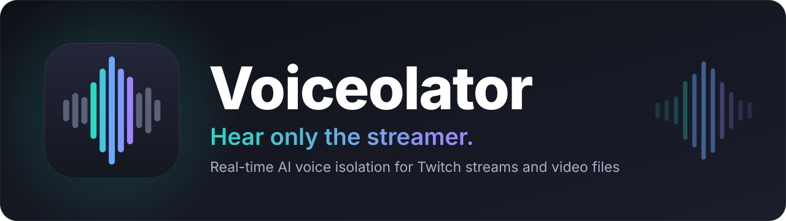
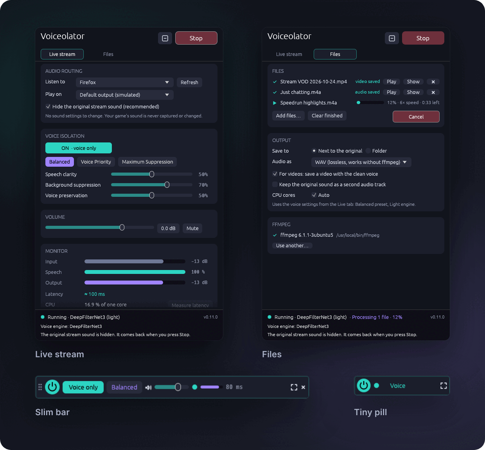

<div align="center">



<br>

[](https://github.com/Schockgeber/voiceolator/actions/workflows/ci.yml)
[](#download)
[](#license)

<br>

<a href="https://github.com/Schockgeber/voiceolator/releases/latest/download/Voiceolator-Setup-Windows-x64.exe"></a>&nbsp;
<a href="https://github.com/Schockgeber/voiceolator/releases/latest/download/Voiceolator-Linux-x86_64.AppImage"></a>&nbsp;
<a href="https://github.com/Schockgeber/voiceolator/releases"></a>

<sub>Free and open source · runs entirely on your PC · no account, no cloud, no ads</sub>

</div>

<br>

**Voiceolator removes background music, game sounds and alerts from a Twitch stream in
real time and plays only the streamer's voice to your headphones.** Your game's sound is
never touched. It works just as well on files: drop in a VOD or a recording and get it
back with nothing but the voice.

<p align="center">
  
  <br><sub>Screenshots of the Linux build, taken in demo mode.</sub>
</p>

## Features

<table>
<tr>
<td width="33%" valign="top">

**Voice only, live**<br>
AI speech isolation (DPDFNet / DeepFilterNet3) removes music, game sounds and alerts
from the stream as you listen: about 80–110 ms delay and 5–15 % of one CPU core.

</td>
<td width="33%" valign="top">

**Nothing to set up**<br>
No virtual cables, drivers or sound settings. Pick your browser and press Start.
Voiceolator captures only that app and hides its original sound while it runs.

</td>
<td width="33%" valign="top">

**Your game stays untouched**<br>
Only the stream is captured and changed. Game audio, voice chat and system sounds
play exactly as before.

</td>
</tr>
<tr>
<td valign="top">

**Files and VODs**<br>
Drop videos or recordings on the window and get `name (voice).mp4`. The picture is
copied unchanged and you can keep the original sound as a second track. Uses several CPU
cores.

</td>
<td valign="top">

**Stays out of the way**<br>
Runs in the system tray, or as a slim bar or tiny pill that stays on top. Global
hotkeys on Windows: <kbd>Ctrl</kbd>+<kbd>Alt</kbd>+<kbd>V</kbd> on/off,
<kbd>Ctrl</kbd>+<kbd>Alt</kbd>+<kbd>M</kbd> mute.

</td>
<td valign="top">

**Private by design**<br>
Everything runs locally on your CPU, with no GPU needed. Nothing is uploaded. The only
download is ffmpeg for video files, and only if you agree.

</td>
</tr>
</table>

## Download

| System | Download | Details |
|---|---|---|
| **Windows 10 (2004+) / 11** | [**Installer**](https://github.com/Schockgeber/voiceolator/releases/latest/download/Voiceolator-Setup-Windows-x64.exe) | `.exe` · recommended. No admin rights needed. Start-menu entry and an optional "Isolate the voice" right-click menu |
| | [Portable](https://github.com/Schockgeber/voiceolator/releases/latest/download/Voiceolator-Portable-Windows-x64.zip) | `.zip` · unzip anywhere, run `Voiceolator.exe` |
| **Linux x86_64** | [**AppImage**](https://github.com/Schockgeber/voiceolator/releases/latest/download/Voiceolator-Linux-x86_64.AppImage) | `chmod +x`, then double-click. Runs on most distributions |
| | [Portable](https://github.com/Schockgeber/voiceolator/releases/latest/download/Voiceolator-Linux-x86_64.tar.gz) | `.tar.gz` · extract, run `./voiceolator`; `./install.sh` adds a menu entry |
| **Command line** | [Windows](https://github.com/Schockgeber/voiceolator/releases/latest/download/Voiceolator-CLI-Windows-x64.zip) · [Linux](https://github.com/Schockgeber/voiceolator/releases/latest/download/Voiceolator-CLI-Linux-x86_64.tar.gz) | For scripting and batch processing |

Every release lists SHA-256 checksums in `SHA256SUMS.txt`. Older versions and release notes
are on the [Releases page](https://github.com/Schockgeber/voiceolator/releases).

<details>
<summary><b>System requirements</b></summary>

<br>

- **Windows:** Windows 10 version 2004 or newer, or Windows 11, 64-bit. The *Quality*
  engine needs the Microsoft Visual C++ Redistributable (x64), which most gaming PCs
  already have. Without it, Voiceolator uses the *Light* engine.
- **Linux:** PipeWire (with `pipewire-pulse`, the default on current distributions) or
  PulseAudio, glibc 2.31 or newer (Ubuntu 20.04, Debian 11, Fedora 32 or newer), X11 or
  Wayland with XWayland.
- **Any modern CPU.** No graphics card power is used for the audio.

</details>

> [!NOTE]
> The builds are not code-signed yet, so Windows SmartScreen may say *"Windows protected
> your PC"*. Click **More info → Run anyway**. You can compare the file's SHA-256 with
> `SHA256SUMS.txt` on the release page.

## Quick start

**Live stream**

1. Play the stream in your browser.
2. In Voiceolator, choose your browser under **Listen to** and your headphones under
   **Play on**.
3. Press **Start** and launch your game.

**Files**

1. Open the **Files** tab and drop audio or video files on the window, or right-click a
   file → *Isolate the voice with Voiceolator* (Windows installer).
2. Press **Isolate voice**. The result appears next to the original as `name (voice).ext`.

The [user guide](docs/USER_GUIDE.md) covers every control, the tray and compact window,
ffmpeg, troubleshooting and known limits.

## How well does it work?

Measured on a 7-scenario test set built from studio speech, music stems and game-like
sound effects. The method and all numbers are in [docs/EVALUATION.md](docs/EVALUATION.md).

<table>
<tr><th>Background</th><th>Removed</th><th>Situation</th><th>Intelligibility (STOI)<br>before → after</th></tr>
<tr><td>Instrumental music</td><td>≈ −57 dB (gone)</td><td>Speech over music</td><td>0.90 → 0.97</td></tr>
<tr><td>Game sounds, explosions, alerts</td><td>≈ −22 dB</td><td>Speech over loud effects</td><td>0.82 → 0.95</td></tr>
<tr><td>Songs with singing</td><td>≈ −11 dB</td><td>Quiet speech under louder music</td><td>0.64 → 0.86</td></tr>
</table>

**Known limits.** Singing is a voice, so it is only partly removed. Game characters,
co-hosts and text-to-speech are voices too and are usually kept. Voiceolator captures the
whole browser, not a single tab. The cleaned voice trails the original by about
80–110 ms (Quality engine) or 60–90 ms (Light engine); **Measure latency** shows the real
value on your PC.

## FAQ

<details>
<summary><b>Will it change how my game sounds?</b></summary>
<br>
No. Voiceolator captures only the app you choose (your browser) and plays the cleaned
voice to the device you pick. Game audio, Discord and system sounds are never captured
or changed.
</details>

<details>
<summary><b>Why do I hear the stream twice?</b></summary>
<br>
Leave <b>Hide the original stream sound</b> ticked (the default). Voiceolator then
silences the browser's own sound while it runs and gives it back when you stop. You
don't need to change any sound settings.
</details>

<details>
<summary><b>Does it need the internet or an account?</b></summary>
<br>
No. All processing happens on your PC. The only network access is the optional ffmpeg
download for video files, and Voiceolator asks before it starts.
</details>

<details>
<summary><b>Does it work with YouTube, Kick, podcasts, …?</b></summary>
<br>
Yes. It works with any app that plays speech: Twitch, YouTube, Kick, podcast apps, media
players. For files, it handles MP4, MKV, WebM, MOV, MP3, M4A, WAV, FLAC, OGG and more.
</details>

<details>
<summary><b>Where is the window after I close it?</b></summary>
<br>
In the system tray, where it keeps cleaning the stream. Click the tray icon or start
Voiceolator again to bring the window back, or right-click the icon → <b>Quit</b>. You can
switch this off in Options.
</details>

<details>
<summary><b>Bluetooth headphones feel delayed</b></summary>
<br>
Bluetooth itself adds 100–250 ms. Wired headphones are much faster. The <b>Light</b>
engine saves another 20 ms.
</details>

## How it works

```
Browser ──► per-app capture ──► AI voice model ──► gate · EQ · limiter ──► jitter buffer ──► Headphones
            (WASAPI process loopback /                                     (clock-drift
             private PipeWire/Pulse sink)                                    compensated)
Game ─────────────────────────────────────────────────────────────────────────────────────► Headphones (untouched)
```

| Crate | Role |
|---|---|
| [`vo-dsp`](crates/vo-dsp) | Voice engines (DPDFNet on ONNX Runtime, DeepFilterNet3 on tract), processing pipeline, presets, drift resampler |
| [`vo-audio`](crates/vo-audio) | Real-time host (capture/DSP/render threads, auto-reconnect), crash watchdog, Windows and Linux backends, latency measurement |
| [`vo-media`](crates/vo-media) | File processing: decoding (Symphonia or ffmpeg), the same pipeline on several cores, audio/video output, verified ffmpeg download |
| [`vo-gui`](crates/vo-gui) | The desktop app (egui): Live and Files tabs, tray, slim bar and pill |
| [`vo-cli`](crates/vo-cli) | Command line: `apps`, `devices`, `run`, `latency`, `bench`, `process`, `ffmpeg` |
| [`vo-eval`](crates/vo-eval) + [`tools/eval`](tools/eval) | Offline evaluation of the exact real-time pipeline |

## Building from source

```bash
# Linux (needs libpulse-dev); Windows: the same with MSVC
cargo build --release -p vo-gui -p vo-cli
python tools/fetch_deps.py --out target/release --linux-ort   # voice model + ONNX Runtime
target/release/Voiceolator
```

[docs/DEVELOPMENT.md](docs/DEVELOPMENT.md) covers cross-compiling, tests, packaging and the
architecture.

## Contributing

Bug reports, ideas and pull requests are welcome. Please read
[CONTRIBUTING.md](CONTRIBUTING.md) first. Security issues: see [SECURITY.md](SECURITY.md).

## Credits

[DPDFNet](https://huggingface.co/Ceva-IP/DPDFNet) by Ceva (Apache-2.0)
<br>
[DeepFilterNet](https://github.com/Rikorose/DeepFilterNet) by Hendrik Schröter (MIT/Apache-2.0)
<br>
[ONNX Runtime](https://github.com/microsoft/onnxruntime) (MIT)
<br>
[egui](https://github.com/emilk/egui) (MIT/Apache-2.0)
<br>
[wasapi-rs](https://github.com/HEnquist/wasapi-rs) (MIT)
<br>
[Symphonia](https://github.com/pdeljanov/Symphonia) (MPL-2.0)
<br>
[rubato](https://github.com/HEnquist/rubato) (MIT)
<br>
[tray-icon](https://github.com/tauri-apps/tray-icon) (MIT/Apache-2.0)
<br>
[ksni](https://github.com/iovxw/ksni) (Unlicense)
<br>
[rfd](https://github.com/PolyMeilex/rfd) (MIT)
<br>
[Inter](https://rsms.me/inter/) typeface in the README graphics (OFL-1.1)
<br>
[FFmpeg](https://ffmpeg.org) is not included; it is used if present, or downloaded on
request
<br>
<br>
All third-party licenses: [THIRD_PARTY_LICENSES.md](THIRD_PARTY_LICENSES.md)

## License

Dual-licensed under [MIT](LICENSE-MIT) or [Apache-2.0](LICENSE-APACHE), at your option.
