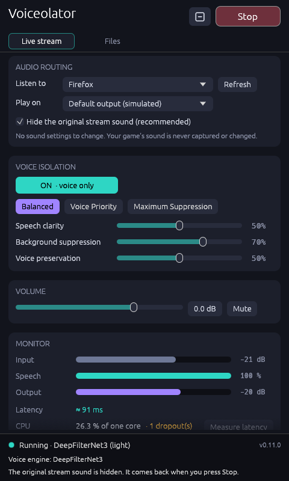
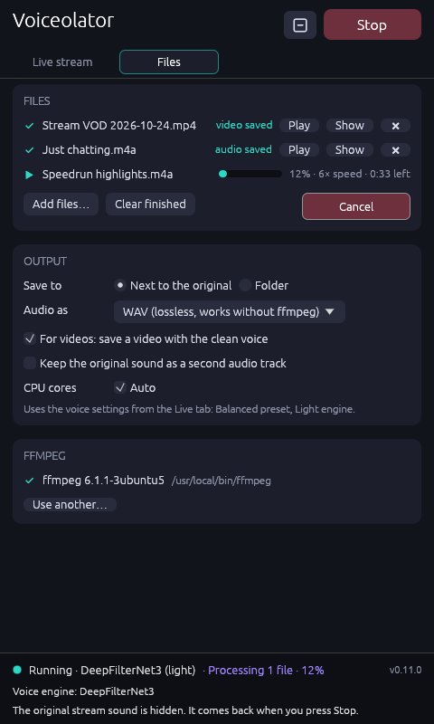
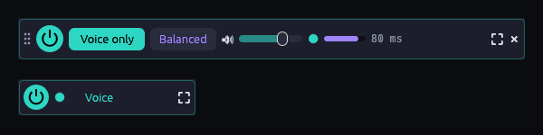

# Voiceolator

**Hear only the streamer while you play.** Voiceolator removes background music, game
sounds and alerts from a Twitch stream (or any app) in real time. It plays just the
streamer's voice to your headphones and leaves your game's sound untouched.

<p align="center">
  
  
</p>
<p align="center"></p>
<p align="center"><sub>Live tab, Files tab, and the slim bar / tiny pill. Captured on Linux in demo mode with simulated devices.</sub></p>

- 🎧 **Voice-only stream audio.** AI speech isolation (DPDFNet / DeepFilterNet3) runs
  locally on your CPU. There is no cloud, no account and no internet access.
- 🎮 **Made for gaming.** Uses about 5–15 % of one CPU core, no GPU, about 80–110 ms
  delay. Your game audio is never captured or changed.
- 🔇 **Nothing to set up.** No cables, no drivers, no sound settings. Voiceolator captures
  just your browser. On Windows it uses "process loopback"; on Linux, a private
  PulseAudio/PipeWire sink. While it runs, it hides the browser's original sound and gives
  it back when you stop.
- 🎬 **Files too.** Drop a VOD, recording or podcast on the window: you get
  `name (voice).mp4` with the picture untouched and only the voice as sound (or WAV, MP3,
  M4A, FLAC audio). Uses several CPU cores; ffmpeg is used for video and is downloaded
  only if you agree.
- 🧩 **Stays out of the way.** System tray, plus a slim bar or a tiny always-on-top pill
  instead of the full window.
- 🐧 **Windows and Linux.** Windows 10/11 installer or portable zip; Linux AppImage or
  tarball.
- 🎚️ **Presets and sliders:**
  - Presets: Balanced, Voice Priority, Maximum Suppression.
  - Sliders: clarity, background suppression, voice preservation.
  - Monitor: live meters, latency and CPU use.
  - Hotkeys (Windows): Ctrl+Alt+V (on/off) and Ctrl+Alt+M (mute).

## Download

Get the latest release from the **Releases** page:

| System | File |
|---|---|
| Windows 10 (2004+) / 11 | `Voiceolator-<version>-windows-setup.exe` (installer, no admin rights needed) or `…-windows-portable.zip` |
| Linux x86_64 | `Voiceolator-<version>-linux-x86_64.AppImage` (`chmod +x`, then run) or `…-linux-x86_64.tar.gz` (`./install.sh` adds a menu entry) |
| Command line | `…-windows-cli.zip` / `…-linux-cli-x86_64.tar.gz` |

**Windows:** the *Quality* engine needs the Microsoft Visual C++ Redistributable (x64).
Most gaming PCs already have it. Without it, Voiceolator falls back to the *Light* engine.

> Windows SmartScreen may warn about an "unrecognized app", because the builds are not
> code-signed. Click **More info → Run anyway**. Check the SHA-256 against
> `SHA256SUMS.txt` on the release page.

**Linux:** you need a desktop with PulseAudio or PipeWire (with `pipewire-pulse`, which is
the default on current distributions) and glibc 2.31 or newer (Ubuntu 20.04, Debian 11,
Fedora 32 or newer). The window runs on X11, and on Wayland through XWayland.

## How to use

1. Play the stream in your browser.
2. In Voiceolator, pick your browser under **Listen to** and your headphones under
   **Play on**.
3. Press **Start**, then launch your game.

**Files:** open the **Files** tab, drop audio or video files on the window and press
**Isolate voice**.

The full [user guide](docs/USER_GUIDE.md) covers controls, files, the tray, the compact
window, troubleshooting and limits.

## How well does it work?

Measured on a 7-scenario test set built from studio speech, music stems and game-like
sound effects. Full details are in [docs/EVALUATION.md](docs/EVALUATION.md).

| Background | Removed |
|---|---|
| Instrumental music | about −57 dB (gone) |
| Game sounds, explosions, alerts | about −22 dB |
| Songs with singing | about −11 dB (singing is a voice, so only partly removed) |

| Situation | Before → after (speech intelligibility, STOI) |
|---|---|
| Speech over music | 0.90 → 0.97 |
| Speech over loud effects | 0.82 → 0.95 |
| Quiet speech under music 5 dB louder | 0.64 → 0.86 |

**Limitations.**

- Sung vocals are only partly removed.
- Other voices are voices too: game characters, co-hosts and TTS are usually kept.
- The whole browser is captured, not a single tab.
- The cleaned voice trails the original by about 80–110 ms (Quality engine) or 60–90 ms (Light). Use **Measure latency** to see the real value on your PC.

## How it works

```
Browser ──WASAPI process loopback / private Pulse sink──► capture ─► ring buffer ─► AI voice model ─► gate/EQ/limiter
                                                                                    │
Headphones ◄── WASAPI render ◄── drift-compensated jitter buffer ◄──────────────────┘
Game ──────────────────────────────────────────────────────────────► Headphones (untouched)
```

| Crate | Role |
|---|---|
| `vo-dsp` | Voice engines (DPDFNet on ONNX Runtime, DeepFilterNet3 on tract), processing pipeline, presets, clock-drift resampler |
| `vo-audio` | Real-time audio host (capture/DSP/render threads, auto-reconnect, MMCSS), crash watchdog, and two backends: Windows (process loopback, hiding the original sound, latency measurement) and Linux (PulseAudio/PipeWire private capture sink, latency measurement) |
| `vo-media` | File processing: decoding (Symphonia or ffmpeg), the same pipeline on several cores, WAV/ffmpeg output and video remuxing, ffmpeg discovery and verified download |
| `vo-gui` | The desktop app (egui): Live and Files tabs, tray (Windows notification area / Linux StatusNotifierItem), slim bar and pill layouts |
| `vo-cli` | Command-line tool: `apps`, `devices`, `run`, `latency`, `bench`, `process`, `ffmpeg` |
| `vo-eval` + `tools/eval` | Offline evaluation of the exact real-time pipeline |

See [docs/DEVELOPMENT.md](docs/DEVELOPMENT.md) for building, testing and packaging.

## Credits

- [DPDFNet](https://huggingface.co/Ceva-IP/DPDFNet) by Ceva (Apache-2.0)
- [DeepFilterNet](https://github.com/Rikorose/DeepFilterNet) by Hendrik Schröter
  (MIT/Apache-2.0)
- [ONNX Runtime](https://github.com/microsoft/onnxruntime) (MIT)
- [wasapi-rs](https://github.com/HEnquist/wasapi-rs) (MIT)
- [egui](https://github.com/emilk/egui) (MIT/Apache-2.0)
- [Symphonia](https://github.com/pdeljanov/Symphonia) (MPL-2.0),
  [rubato](https://github.com/HEnquist/rubato) (MIT),
  [tray-icon](https://github.com/tauri-apps/tray-icon) (MIT/Apache-2.0),
  [ksni](https://github.com/iovxw/ksni) (Unlicense),
  [rfd](https://github.com/PolyMeilex/rfd) (MIT)
- [FFmpeg](https://ffmpeg.org) is not included; it is used if present or downloaded on
  request from [gyan.dev](https://www.gyan.dev/ffmpeg/builds/) (Windows) or
  [johnvansickle.com](https://johnvansickle.com/ffmpeg/) (Linux).

All third-party licenses are listed in [THIRD_PARTY_LICENSES.md](THIRD_PARTY_LICENSES.md).

## License

Dual-licensed under [MIT](LICENSE-MIT) or [Apache-2.0](LICENSE-APACHE), at your option.
